<h1 align="center">BoneScope</h1>

<h3 align="center">Bone Tumor Segmentation &amp; Model Comparison Workspace</h3>

<p align="center">
  Explore bone tumor masks on X-rays and compare ViT and EfficientViT predictions, accuracy, and inference performance on BTXRD.
</p>

<p align="center">
  <a href="README.md"></a>
  <a href="README.vi.md"></a>
</p>

<p align="center">
  
  
  
  
  
</p>

<p align="center"><strong>Digital Image Processing Seminar · BTXRD Bone Tumor Segmentation</strong></p>

<p align="center">
  <a href="#overview">Overview</a> ·
  <a href="#features">Features</a> ·
  <a href="#gallery">Gallery</a> ·
  <a href="#architecture">Architecture</a> ·
  <a href="#quick-start">Quick Start</a> ·
  <a href="#evaluation">Evaluation</a> ·
  <a href="#documentation">Documentation</a>
</p>

---

## Overview

BoneScope compares **Vision Transformer (ViT-B/16)** and **EfficientViT-Seg-B1** for binary bone tumor segmentation. Both models predict a foreground mask from a 224 × 224 X-ray. The repository contains the training code, Kaggle notebooks, and a local browser demo that shows model predictions alongside ground truth.

## Features

- Browse 561 test images with polygon-derived ground truth and model overlays.
- Compare Dice, IoU, latency, throughput, RAM, CPU, VRAM, parameter count, and GFLOPs on the same image.
- Run both models on the same 560 quality-checked test images, track progress, and stop after the current image.
- After a completed run, view the aggregate charts and download a ZIP with PNG charts, per-image CSV, summary data, and the exact test-image selection.
- Filter SQLite-backed inference history by session or batch run, expand charts, and export CSV.

## Gallery

| ViT segmentation | EfficientViT segmentation |
| --- | --- |
| <a href="material/ViT-seg.png">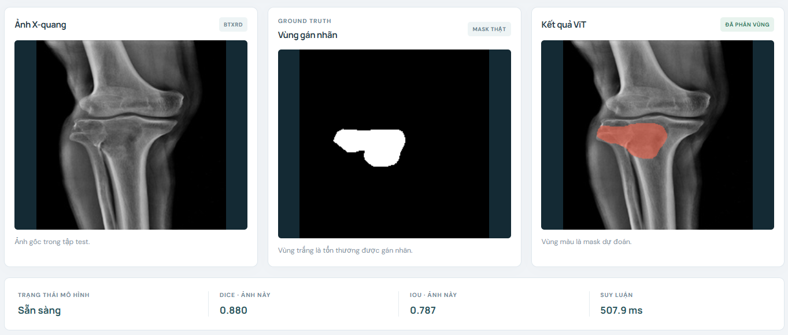</a> | <a href="material/EViT-seg.png">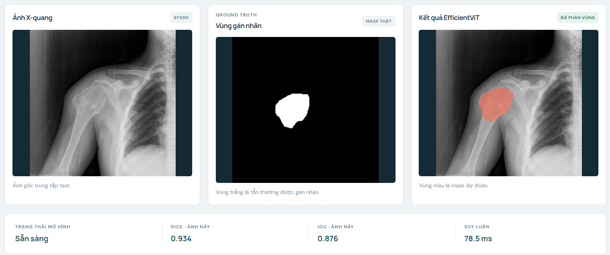</a> |

### Live segmentation · 0:16

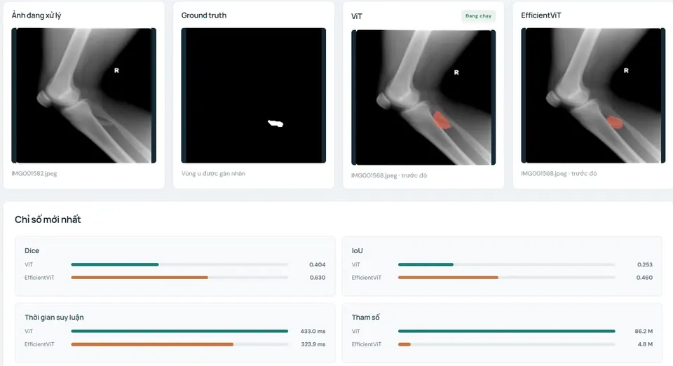

[Original MP4](material/chay-tung-fig-evit-vit.mp4)

### Inference history · 0:52

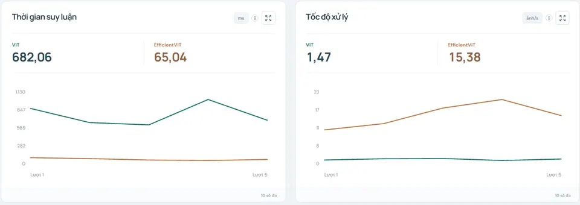

[Original MP4](material/vid-compare-vit-evit.mp4)

### Evaluation charts

| Aggregate accuracy | Dice per tumor image |
| --- | --- |
| <a href="material/accuracy.png">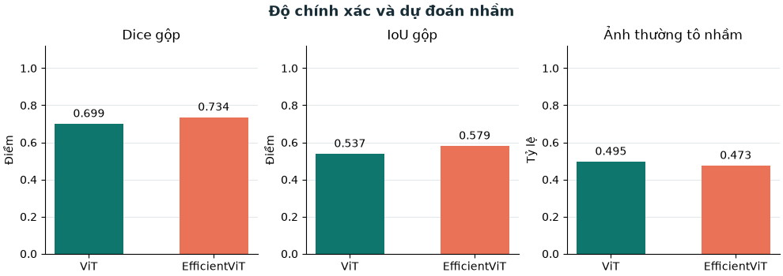</a> | <a href="material/paired-dice.png">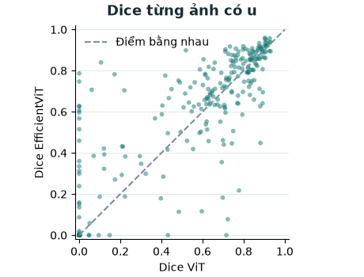</a> |
| **Latency and throughput** | **Runtime resources** |
| <a href="material/latency.png">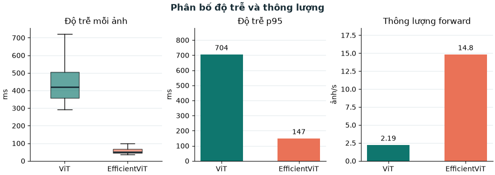</a> | <a href="material/resources.png">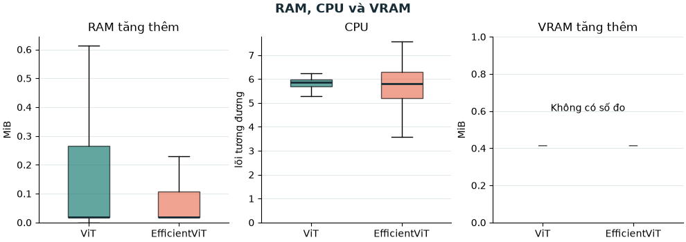</a> |
| **Parameters and GFLOPs** | **Side-by-side predictions** |
| <a href="material/complexity.png">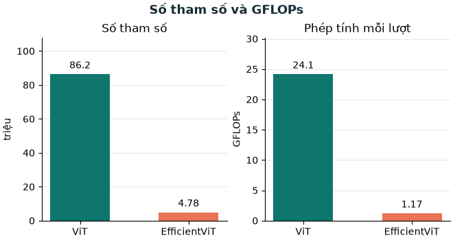</a> | <a href="material/ViT-EViT-compare.png">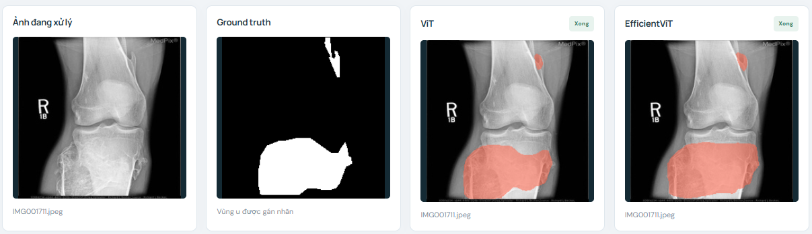</a> |

## Architecture

Both models take a 224 × 224 RGB X-ray with ImageNet normalization. The demo resizes each model's logits to 224 × 224, applies sigmoid, and thresholds at 0.5. The backend compares the masks against the rasterized BTXRD polygons, sends overlays and metrics to the browser, and stores measurements in SQLite.

### ViT-B/16 with convolutional skip connections

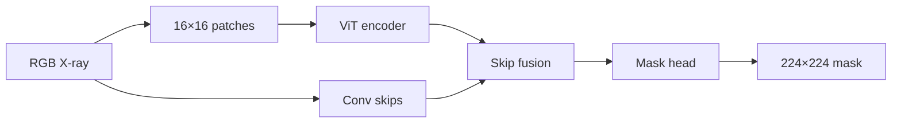

| Stage | What it does |
| --- | --- |
| Patch embedding and encoder | Produces 196 patch tokens with 768 features each. Adds CLS and position embeddings, then applies 12 Transformer blocks with 12 heads. |
| Context projection | Drops CLS, reshapes the patch tokens, and projects them to 14×14×128 with a 1×1 convolution. |
| Conv skips | Stride-2 convolutions extract 112×112×24, 56×56×48, and 28×28×64 features from the original input. |
| Skip fusion | Bilinear upsampling and concatenation at each scale give 28×28×96, 56×56×64, and 112×112×32 features. Each fusion block uses conv 3×3, GroupNorm, and GELU. |
| Mask head | A 1×1 convolution produces 112×112×1 logits before bilinear upsampling to the input size. |

[ViT implementation](src/xla/models/vit_detail.py)

### EfficientViT-Seg-B1

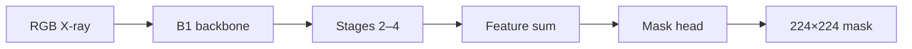

| Stage | What it does |
| --- | --- |
| Stem and stage 1 | Extracts 112×112×16 and then 56×56×32 features. |
| Stages 2–4 | Outputs 28×28×64, 14×14×128, and 7×7×256. Stage 2 uses three MBConv blocks. Stages 3 and 4 begin with downsampling MBConv, then use three and four EfficientViT blocks with LiteMLA and MBConv. |
| Feature sum | Projects each stage to 64 channels with a 1×1 convolution, resizes by 1×, 2×, and 4×, then adds the three 28×28 maps. |
| Mask head | Three residual MBConv blocks and a 1×1 convolution produce 28×28×1 logits before bilinear upsampling to the input size. |

[Demo adapter](demo/backend/models.py) · [Pinned upstream segmentation head](https://github.com/mit-han-lab/efficientvit/blob/de7d7733cc0329f391b33f1f459271562ec27bd5/efficientvit/models/efficientvit/seg.py)

### Repository tree

```text
start-web.ps1      Windows web launcher
requirements.txt   Python dependencies for the demo and training
demo/              Browser UI, HTTP API, and SQLite storage
src/xla/           Data loaders, models, training loops, and Segmenter code
scripts/           Data preparation, training, and notebook packaging
notebooks/         Kaggle jobs and metadata
configs/           Model, dataset, and experiment configuration
data/              Local datasets and split manifests
outputs/           Checkpoints, Kaggle results, and demo history
docs/              Data protocol, experiments, and references
material/          Demo screenshots and video clips
paper/             Research papers
tests/             Python tests
```

## Quick Start

Install Python 3.10 or newer. From the repository root on Windows, run:

```powershell
powershell -ExecutionPolicy Bypass -File .\start-web.ps1
```

Open **http://127.0.0.1:8765** when the server reports that it is ready. Press **Ctrl+C** to stop it. Add `-Port 8766` if the default port is busy.

The launcher creates or reuses a Python environment and keeps compatible packages, including existing CPU or CUDA PyTorch builds. On the first run it downloads the BTXRD archive, test manifest, and both model checkpoints from Kaggle (about 410 MB total, plus any missing Python packages). It checks SHA-256 and reuses verified files on later runs. **Internet access is required for the first run. A Kaggle account or CLI is optional.** [Python requirements](requirements.txt)

| Public Kaggle release | Contents |
| --- | --- |
| [BTXRD dataset and splits](https://www.kaggle.com/datasets/vtan2405/bonescope-btxrd-splits) | Image and mask annotation archive, train/validation/test manifests, and the matched 1,302-image tumor-only training manifest |
| [ViT and EfficientViT checkpoints](https://www.kaggle.com/datasets/vtan2405/bonescope-btxrd-checkpoints) | The two PyTorch weight files used by the web demo |

| Demo model | Default checkpoint |
| --- | --- |
| ViT-B/16 with convolutional skip connections | `outputs/kaggle_checks/vit-detail/best_vit_detail.pt` · epoch 32 · threshold 0.5 |
| EfficientViT-Seg-B1 | `outputs/kaggle_checks/efficientvit/best_evit_seg_btxrd.pth` · threshold 0.5 |

The archive is cached under `data/raw/` and the test manifest under `data/splits/`. Git ignores downloaded weights, dataset files, and generated reports. To override a checkpoint, set `XLA_VIT_CHECKPOINT` or `XLA_EFFICIENTVIT_CHECKPOINT`.

## Evaluation

### Dataset

Kaggle version 2 stores the exact `btxrd_final.zip` archive as `btxrd_final.bin` to preserve its checksum. The launcher restores the `.zip` extension locally. The archive comes from Hugging Face revision `cf8b0569b18e43e7cecab412a06e60aeaf258b32`. The manifests exclude byte-identical images with conflicting labels and training images duplicated in held-out sets. The original BTXRD dataset is published by Yao et al. under CC BY 4.0. [Original dataset record](https://api.figshare.com/v2/articles/27865398) · [Split protocol](docs/btxrd_data.md)

| Split after filtering | Normal | Tumor | Total |
| --- | ---: | ---: | ---: |
| Train | 1,311 | 1,302 | 2,613 |
| Validation | 282 | 280 | 562 |
| Test | 281 | 280 | 561 |

### Kaggle results

The head-to-head experiment used the same **1,302 tumor-positive training images**, full validation and test sets, and threshold 0.5 with horizontal-flip test-time augmentation. EfficientViT led by 3.53 percentage points in Dice and 4.33 points in IoU. The earlier Mask Transformer score comes from validation. [Comparison output](https://www.kaggle.com/code/vtan2405/xla-btxrd-vit-detail-vs-efficientvit/output)

| Experiment | Split | Pixel micro Dice | Pixel micro IoU |
| --- | --- | ---: | ---: |
| EfficientViT-Seg-B1 | Test | **0.7404** | **0.5878** |
| ViT-B/16 with convolutional skip connections | Test | 0.7051 | 0.5445 |
| ViT-B/16 + Mask Transformer, threshold 0.7 | Validation | 0.6238 | 0.4533 |

The demo uses one forward pass per model per image. It reports per-image Dice and IoU. When both masks are empty, each score is 1. Batch runs also report pixel-pooled Dice and IoU. Latency measures the forward pass. RAM uses process RSS, VRAM uses PyTorch tensor allocations, and GFLOPs reflect operators supported by the PyTorch counter.

Before a demo batch run, the backend checks image decoding, dimensions, SHA-256, annotation and mask consistency, and byte-level duplicates. The current selection contains 279 tumor images and 281 normal images. The browser and ZIP share the same Matplotlib charts.

## Documentation

| Guide | Contents |
| --- | --- |
| [BTXRD data protocol](docs/btxrd_data.md) | Dataset revision, duplicate filtering, and split generation |
| [Experiments](docs/experiments.md) | Training configurations, Kaggle notebooks, and results |
| [Sources and licenses](docs/sources.md) | Papers, models, and upstream licenses |

### Development

```powershell
$env:PYTHONUTF8 = "1"
.\.venv\Scripts\python.exe -m pip install -e ".[dev]"
.\.venv\Scripts\python.exe -m xla doctor
.\.venv\Scripts\python.exe -m pytest -q
```

Run `python -m demo.build_site` with the local dataset to build a static demo with images and ground truth.
