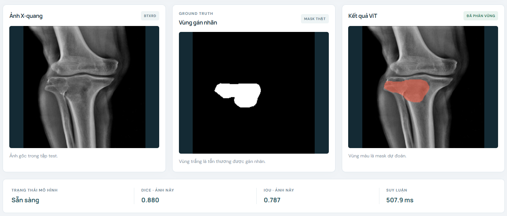
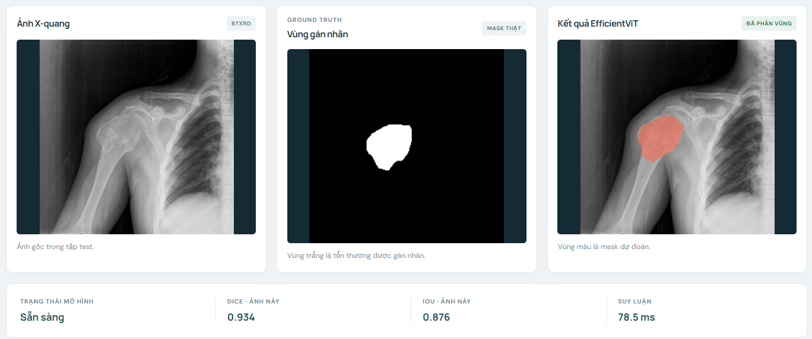
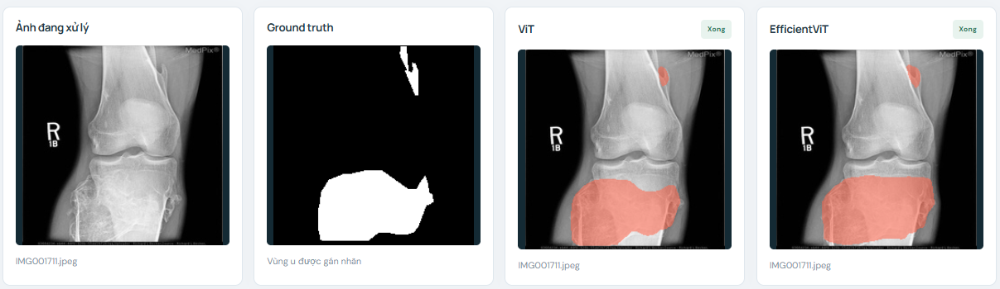
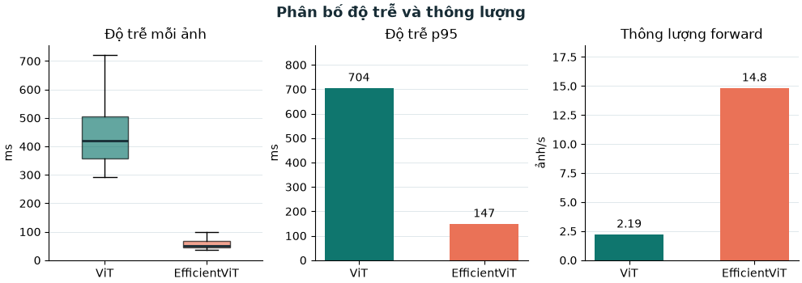
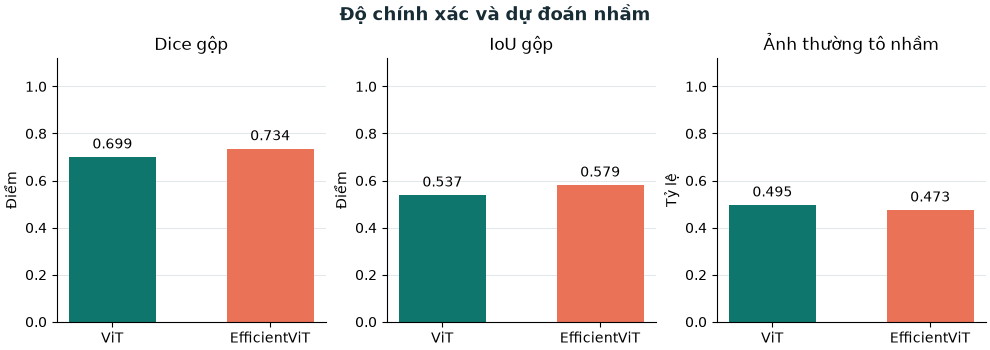
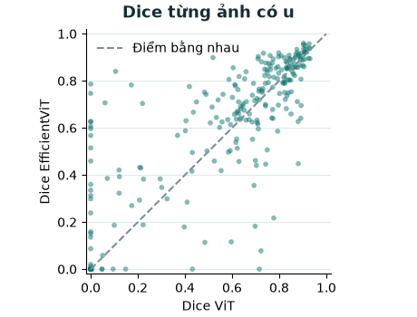
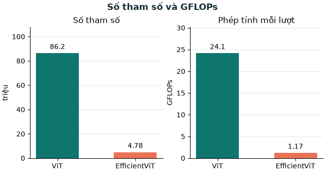
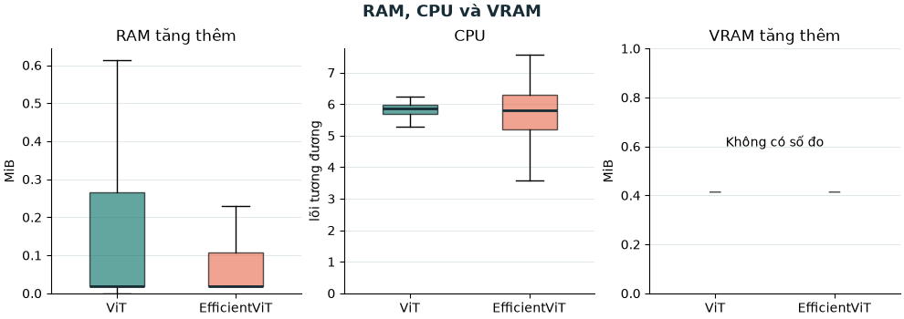

<h1 align="center">BoneScope</h1>

<h3 align="center">Phân vùng u xương và so sánh mô hình trên ảnh X-quang</h3>

<p align="center">
  Xem dự đoán của ViT và EfficientViT cạnh mask ground truth, so sánh độ chính xác và đo hiệu năng suy luận trên BTXRD.
</p>

<p align="center">
  <a href="README.md"></a>
  <a href="README.vi.md"></a>
</p>

<p align="center">
  
  
  
  
  
</p>

<p align="center"><strong>Seminar Xử lý ảnh · Phân vùng u xương trên BTXRD</strong></p>

<p align="center">
  <a href="#tổng-quan">Tổng quan</a> ·
  <a href="#tính-năng">Tính năng</a> ·
  <a href="#minh-họa">Minh họa</a> ·
  <a href="#kiến-trúc">Kiến trúc</a> ·
  <a href="#chạy-nhanh">Chạy nhanh</a> ·
  <a href="#đánh-giá">Đánh giá</a> ·
  <a href="#tài-liệu">Tài liệu</a>
</p>

---

## Tổng quan

BoneScope là project seminar so sánh **Vision Transformer (ViT-B/16)** và **EfficientViT-Seg-B1** trên bài toán phân vùng nhị phân u xương. Hai mô hình dự đoán mask từ ảnh X-quang 224 × 224. Repo gồm mã huấn luyện, notebook Kaggle và demo chạy trên trình duyệt.

## Tính năng

- Duyệt 561 ảnh test, xem ground truth và dự đoán của từng mô hình.
- So sánh Dice, IoU, độ trễ, throughput, RAM, CPU, VRAM, số tham số và GFLOPs trên cùng ảnh.
- Chạy hai mô hình theo lô trên cùng 560 ảnh test đã kiểm tra, theo dõi tiến độ và dừng sau ảnh hiện tại.
- Khi lượt chạy hoàn tất, xem biểu đồ tổng hợp và tải ZIP gồm biểu đồ PNG, CSV từng ảnh, số liệu tổng hợp và danh sách ảnh đã lọc.
- Lọc lịch sử theo phiên hoặc lượt chạy, mở rộng biểu đồ và xuất CSV. Lịch sử lưu trong `outputs/demo_history.sqlite3`.

## Minh họa

| Phân vùng với ViT | Phân vùng với EfficientViT |
| --- | --- |
| <a href="material/ViT-seg.png"></a> | <a href="material/EViT-seg.png"></a> |

| So sánh trực tiếp hai mô hình | Độ trễ và tốc độ xử lý |
| --- | --- |
| <a href="material/chay-tung-fig-evit-vit.mp4"></a> | <a href="material/vid-compare-vit-evit.mp4"></a> |
| [Xem hai mô hình phân vùng qua từng ảnh · 0:16](material/chay-tung-fig-evit-vit.mp4) | [Xem độ trễ và tốc độ cập nhật qua các lượt · 0:52](material/vid-compare-vit-evit.mp4) |

<details>
<summary>Xem thêm biểu đồ đánh giá</summary>

| Độ chính xác tổng hợp | Dice trên từng ảnh có u |
| --- | --- |
| <a href="material/accuracy.png"></a> | <a href="material/paired-dice.png"></a> |
| **Số tham số và GFLOPs** | **Tài nguyên suy luận** |
| <a href="material/complexity.png"></a> | <a href="material/resources.png"></a> |

</details>

## Kiến trúc

Server HTTP cục bộ đọc ảnh và annotation từ BTXRD, raster hóa polygon thành mask ground truth và gọi mô hình PyTorch. Giao diện HTML/CSS/JavaScript lấy ảnh, dự đoán và chỉ số qua API. SQLite lưu lịch sử suy luận và kết quả chạy theo lô.

<details>
<summary>Cây thư mục</summary>

```text
start-web.ps1      Launcher Windows
requirements.txt   Thư viện Python cho demo và huấn luyện
demo/              Giao diện, HTTP API và SQLite
src/xla/           Loader, mô hình, vòng lặp train và mã Segmenter
scripts/           Chuẩn bị dữ liệu, train và đóng gói notebook
notebooks/         Job và metadata Kaggle
configs/           Cấu hình mô hình, dataset và thí nghiệm
data/              Dataset và manifest cục bộ
outputs/           Checkpoint, kết quả Kaggle và lịch sử demo
docs/              Dữ liệu, thí nghiệm và nguồn
material/          Ảnh chụp và video demo
paper/             Bài báo tham khảo
tests/             Kiểm thử Python
```

</details>

## Chạy nhanh

Cần Python 3.10 trở lên. Từ thư mục project, chạy:

```powershell
powershell -ExecutionPolicy Bypass -File .\start-web.ps1
```

Mở **http://127.0.0.1:8765** khi terminal báo server sẵn sàng. Nhấn **Ctrl+C** để dừng. Thêm `-Port 8766` nếu cổng mặc định đang bận.

Launcher tạo hoặc dùng lại môi trường Python và giữ các thư viện tương thích, kể cả PyTorch CPU/CUDA. Lần đầu script tải archive BTXRD, danh sách ảnh test và hai checkpoint từ Kaggle, tổng khoảng 410 MB chưa tính thư viện còn thiếu. Script kiểm tra SHA-256 và dùng lại file đã xác thực ở các lần sau. **Lần đầu cần Internet. Tài khoản và CLI Kaggle là tùy chọn.**

| Gói public trên Kaggle | Nội dung |
| --- | --- |
| [Dữ liệu BTXRD và các tập](https://www.kaggle.com/datasets/vtan2405/bonescope-btxrd-splits) | Archive ảnh và annotation, manifest train/validation/test, danh sách 1.302 ảnh train có u dùng để so sánh hai model |
| [Checkpoint ViT và EfficientViT](https://www.kaggle.com/datasets/vtan2405/bonescope-btxrd-checkpoints) | Hai file trọng số PyTorch dùng trên web |

| Mô hình trong demo | Checkpoint mặc định |
| --- | --- |
| ViT-B/16 có skip tích chập | `outputs/kaggle_checks/vit-detail/best_vit_detail.pt` · epoch 32 · ngưỡng 0,5 |
| EfficientViT-Seg-B1 | `outputs/kaggle_checks/efficientvit/best_evit_seg_btxrd.pth` · ngưỡng 0,5 |

Archive lưu ở `data/raw/` và danh sách ảnh test lưu ở `data/splits/`. Git bỏ qua trọng số, dữ liệu đã tải và kết quả sinh ra khi chạy. Để dùng checkpoint khác, đặt `XLA_VIT_CHECKPOINT` hoặc `XLA_EFFICIENTVIT_CHECKPOINT`.

## Đánh giá

### Dữ liệu

Phiên bản 2 trên Kaggle lưu nguyên archive `btxrd_final.zip` dưới tên `btxrd_final.bin` để giữ checksum. Launcher lưu lại với đuôi `.zip` trên máy. Archive lấy từ revision `cf8b0569b18e43e7cecab412a06e60aeaf258b32` trên Hugging Face. Manifest loại ảnh trùng byte có nhãn xung đột và ảnh train trùng với tập giữ lại. Dữ liệu BTXRD gốc do Yao và cộng sự phát hành theo CC BY 4.0. [Dữ liệu gốc](https://api.figshare.com/v2/articles/27865398) · [Kiểm tra và tái tạo split](docs/btxrd_data.md)

| Tập sau lọc | Bình thường | Có u | Tổng |
| --- | ---: | ---: | ---: |
| Train | 1.311 | 1.302 | 2.613 |
| Validation | 282 | 280 | 562 |
| Test | 281 | 280 | 561 |

Job so sánh trực tiếp ViT mới với EfficientViT dùng đúng **1.302 ảnh train có u** như job EfficientViT gốc và toàn bộ validation/test ở trên. Các job Segmenter cũ dùng cả ảnh thường khi train.

### Kết quả Kaggle

| Thí nghiệm | Tập đánh giá | Dice pixel gộp | IoU pixel gộp |
| --- | --- | ---: | ---: |
| EfficientViT-Seg-B1, ngưỡng 0,5 và TTA lật ngang | Test | 0,7404 | 0,5878 |
| ViT-B/16 có skip tích chập, cùng ngưỡng và TTA | Test | 0,7051 | 0,5445 |
| ViT Mask Transformer trước đây, ngưỡng 0,7 | Validation | 0,6238 | 0,4533 |

Trên cùng 561 ảnh test, EfficientViT dẫn ViT có skip tích chập 3,53 điểm phần trăm Dice và 4,33 điểm phần trăm IoU. Điểm của Mask Transformer trước đây đo trên validation. [Kaggle Output của job so sánh](https://www.kaggle.com/code/vtan2405/xla-btxrd-vit-detail-vs-efficientvit/output) · [Cấu hình và kết quả thí nghiệm](docs/experiments.md)

Demo dùng một lượt forward mỗi mô hình trên mỗi ảnh. Dice/IoU trên ảnh đang xem là số đo từng ảnh. Khi mask dự đoán và ground truth cùng rỗng, cả hai chỉ số bằng 1. Bảng theo lô có thêm Dice/IoU pixel gộp từ TP, FP, FN. Độ trễ đo lượt forward, RAM lấy theo RSS tiến trình, VRAM dựa trên vùng tensor PyTorch cấp phát và GFLOPs dựa trên các toán tử bộ đếm PyTorch hỗ trợ.

Trước khi chạy theo lô, backend kiểm tra ảnh đọc được, đúng kích thước và SHA-256, khớp annotation và mask, rồi bỏ ảnh trùng byte. Tập đã lọc gồm 279 ảnh có u và 281 ảnh bình thường. Web và ZIP dùng chung biểu đồ Matplotlib.

## Tài liệu

| Tài liệu | Nội dung |
| --- | --- |
| [Dữ liệu BTXRD](docs/btxrd_data.md) | Revision, lọc ảnh trùng và tái tạo split |
| [Thí nghiệm](docs/experiments.md) | Cấu hình train, notebook Kaggle và kết quả |
| [Nguồn và giấy phép](docs/sources.md) | Bài báo, mô hình và giấy phép đi kèm |

### Phát triển

Sau khi có môi trường Python, cài package dự án ở chế độ editable để chạy CLI và test:

```powershell
$env:PYTHONUTF8 = "1"
.\.venv\Scripts\python.exe -m pip install -e ".[dev]"
.\.venv\Scripts\python.exe -m xla doctor
.\.venv\Scripts\python.exe -m pytest -q
```

Để tạo bản demo tĩnh chứa ảnh và ground truth từ dữ liệu đã có, chạy `python -m demo.build_site`.
